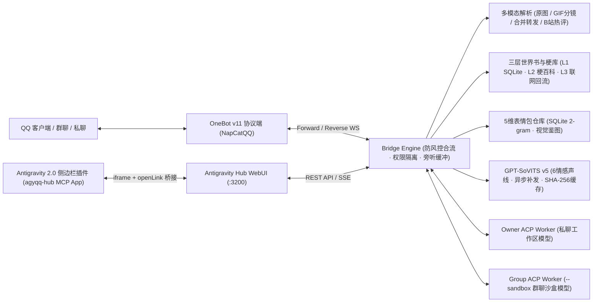

<h1 align="center">Antigravity QQ Bridge</h1>

<p align="center">
  <strong>直接复用本机 Google Antigravity（AGY 2 / CLI）的跨端 QQ AI 伴侣桥接系统</strong><br/>
  持久化 <code>agy acp --stdio</code> 双通道大脑 · 可调上下文预算与无感记忆压缩 · 原生视觉 / GIF 分镜 / 合并转发 / B站热评解析 · 三层活体世界书与梗百科 · GPT-SoVITS v5 情感语音 · Antigravity Hub 可视化管控台
</p>

<p align="center">
  
  
  
  
  
</p>

---

## 目录

- [项目简介](#项目简介)
- [系统架构](#系统架构)
- [核心功能特性](#核心功能特性)
- [环境要求](#环境要求)
- [安装与配置](#安装与配置)
  - [方式一：让 AI Agent 自动代装（推荐）](#方式一让-ai-agent-自动代装推荐)
  - [方式二：一键安装程序（交互 / 参数化）](#方式二一键安装程序交互--参数化)
  - [方式三：纯手动安装步骤](#方式三纯手动安装步骤)
- [启动方式](#启动方式)
- [Antigravity 2.0 侧边栏插件](#antigravity-20-侧边栏插件)
- [常用 QQ 指令](#常用-qq-指令)
- [项目结构](#项目结构)
- [测试与诊断](#测试与诊断)
- [安全与隐私设计](#安全与隐私设计)
- [鸣谢 / Acknowledgments](#鸣谢--acknowledgments)
- [开源许可与免责声明](#开源许可与免责声明)

---

## 项目简介

**Antigravity QQ Bridge** 是一套轻量、独立部署的 QQ AI 伴侣桥接系统：

- **零额外商业 API 订阅依赖**：直接常驻调用你本机已登录的 **Google Antigravity CLI**（`agy acp --stdio` 持久化会话），开机握手一次即可长连接复用，彻底告别逐条冷启动延迟。
- **极致轻量与透明可控**：基于 Node.js `>=22.13.0` 内置 `node:sqlite` 与原生模块，整个核心**仅有 1 个外部运行时依赖（`ws`）**，所有数据、会话记忆与配置全部保存在你自己的电脑本地。
- **既懂群聊氛围又守安全底线**：私聊主人通道可按需调用本机工具协助开发，群聊通道强制运行于独立 `--sandbox` 沙盒并执行 4 层权限硬拦截；同时兼顾自然群聊接话节奏、防风控合流、友商机器人防互刷与全场景看图玩梗。
- **专为 Antigravity 2.0（AGY 2）打造的可视化控制台**：所有模型、人格、上下文上限、权限白名单、声线参数、世界书/梗库、表情仓库与免连 QQ 演练场都支持浏览器或 **Antigravity 2.0 侧边栏 / 辅助面板**实时热更新。

---

## 系统架构



---

## 核心功能特性

### 1. 双通道持久化 ACP 大脑 & 可调上下文预算
- **私聊 / 群聊双进程分流**：独立维护主人工作区通道与群聊 `--sandbox` 沙盒通道，可分别配置模型与思考强度，私聊与各个群聊会话上下文完全隔离。
- **可调上下文上限（16K – 2M / 不限）**：支持在 Antigravity Hub 的「模型与人格」与「Token 与会话」面板中通过滑块、快捷档位（`64K` / `128K` / `256K` / `512K` / `1M` / `不限`）或自定义数值实时热更新单会话预算与单轮字符上限（`maxPromptChars`），无需重启服务。
- **无感记忆压缩接力（方案 A）**：达到上下文预算后，在回复发出后的后台静默整理《前情记忆交接单》（归档至 `data/session-summaries/` 并落盘防重启丢失），连同最近若干轮原话无缝接力至清爽新会话；亦支持切换方案 B/C、清空或手动 `/压缩`。

### 2. 全场景原生视觉、GIF 分镜、合并转发与 B 站热评解析
- **原生识图与 6 小时旁听补图**：自动将直发图、引用图、以及群聊潜水期间 6 小时内带有 `[HH:MM]` 时间戳的背景聊天气氛与近期图片带入上下文；遇到“他刚发的是什么梗”“上面那张图怎么看”等回指表达时自动补带对应历史图，闲聊打招呼不误带。
- **动态 GIF 时序分镜**：借助本机 FFmpeg 将动态表情/动图自动拼接为带编号的 `2×1` / `3×1` / `2×2` / `3×2` 连环画，完整保留动作演变与结尾反转（表情库仍完整保存原始 GIF）。
- **QQ 合并转发安全展开**：直发、引用或近期旁听的 QQ 合并转发记录自动经 `get_forward_msg` 展开（限深 2 层、限条数与字符防爆上下文），连同转发内的编号图片、动图与 B 站链接一并送入多模态通道。
- **B 站卡片与链接深度解析**：收到 B 站 QQ 小程序分享卡片、`b23.tv` 短链或 `BV` 号时，并行拉取封面图、真实 UP 主、完整简介、播放/点赞/投币/收藏/弹幕数据、UP 主置顶评论与高赞热评（纯只读公开接口 + 严格 SSRF 与提示词注入防线）。

### 3. 三层查梗与活体世界书
- **L1 活体世界书（最高优先，`data/lorebook.db`）**：存放群友黑话、角色自设与魔改热梗；兼容 SillyTavern 🔵蓝灯常驻 / 🟢绿灯关键词 / 次级过滤 / 优先级 / 会话冷却去重 / 分群作用域隔离，支持 SillyTavern World Info JSON 双向导入与导出。
- **L2 只读公共梗百科（可选，`data/memes.db`）**：兼容 [dsh-memewiki](https://github.com/thawline/dsh-memewiki) / `cnmeme.wiki` 6,792+ 词条，内存检索 `<1ms`，优先注入「怎么用/怎么接」方便自然入戏；支持 Hub 内搜索、一键复制到 L1 魔改、0-Token 增量同步（`scripts/sync-cnmeme.mjs`），并内置 **0–100「串子程度」** 玩梗风格滑杆。
- **L3 联网兜底回流**：L1/L2 均未命中时按需触发安全只读联网搜索（`search_web`），查完自动通过隐藏标记无感收录进 L1，越聊越懂群。

### 4. OneBot v11 防风控 & 自然群聊节奏
- 完整适配 **NapCatQQ**，同时支持 **Forward WS**（默认 `ws://127.0.0.1:13001`）与 **Reverse WS**。
- 内置 `2.5s` 智能防抖合流窗口、多发言人合流精准聚焦、长文拟人分段延时、`90s` 重复去重与触发风控自动退避。
- 群聊支持被 `@` / 回复 / 关键词唤醒后的**活跃跟聊窗口**、连续 `[静默]` 自动退窗、以及**友商机器人防互刷**（`peerBotUsers` 仅旁听不跟聊 + `peerBotNames` 称呼避让）。

### 5. Owner Guard 4 层权限隔离
- `ownerUsers` 白名单私聊可选择性放行本机 Antigravity 工作区工具能力。
- 所有群聊与非主人私聊强制走独立空目录 `--sandbox` 子进程，并在 `session/request_permission` 层硬拦截本机工具调用，仅放行只读表情包/世界书手册与只读联网搜索 `search_web`。

### 6. GPT-SoVITS v5 六情感声线 & 5 维表情包仓库
- **双轨语音极速体验**：文字与表情包立即发出，语音在后台串行合成后无感补发，彻底消除等待焦虑；完整支持 6 情感参考音频、13 项 v5 推理参数热调、上线/切权重自动预热 CUDA 与 `SHA-256` 秒回缓存。
- **5 维表情包卡片库（`data/stickers.db`）**：支持自动同步 QQ 收藏表情、视觉鉴图自动筛选、按需读取目录手册 `data/sticker-catalog.md`（平时 0 上下文占用）与 `2-gram` 中文检索兜底。

### 7. Antigravity Hub 管控台 & Antigravity 2.0 侧边栏插件
- 8 大功能页签覆盖全链路：总览与 NapCatQQ 扫码登录、模型与人格（含上下文上限滑块）、GPT-SoVITS 声线试听、群聊权限矩阵、Token 吞吐与上下文压缩进度、表情包仓库、活体世界书与 L2 梗百科、免连 QQ 端到端演练场。
- 仓库内置完整的 **Antigravity 2.0（AGY 2）侧边栏 MCP App 插件源码**（[`plugins/agyqq-hub`](plugins/agyqq-hub/README.md)）：支持左侧全局整页（`global`）与右侧辅助面板（`aux_pane`）两种入口，一键自动检测并拉起本地服务，并在面板内直接点击「打开扫码登录」唤起本机浏览器。

---

## 环境要求

| 组件 | 要求 | 说明 |
| :--- | :--- | :--- |
| **Node.js** | `>= 22.13.0`（必选） | 使用内置 `node:sqlite` 与 `node:test`，外部运行时依赖仅 `ws` |
| **Google Antigravity 2.0 / CLI (`agy`)** | 已安装并完成账号登录（必选） | 提供 `agy acp --stdio` 持久化会话通道；AGY 2 桌面端还支持侧边栏插件 |
| **OneBot v11 协议端** | 自备 NapCatQQ 或任意标准 OneBot v11 协议端（必选） | **提示**：`NapNeko/NapCatQQ` 原仓库已进入 `Ending` 停更状态，本仓库不包含协议端本体。目前仅实测过 NapCatQQ，其他标准 OneBot v11 协议端未实机验证（差异见下方说明） |
| **FFmpeg** | 可选，强烈推荐 | 用于动态 GIF 时序分镜；加入系统 `PATH` 或配置 `vision.ffmpegPath` |
| **GPT-SoVITS v5** | 可选 | 需要六情感真人语音合成时部署，独立监听 `19880`（可自动探测备选端口） |
| **L2 梗百科词库 (`data/memes.db`)** | 可选 | 离线公共梗词库，未随仓库分发，可通过安装程序一键同步或自行放入 |

> **平台说明**：核心 Node.js 服务、一键安装脚本 `scripts/install.mjs`、测试套件与 Hub WebUI 跨平台支持 Windows / macOS / Linux；根目录的 `.bat` / `.ps1` 快捷脚本面向 Windows，macOS / Linux 用户可直接运行 `node scripts/install.mjs` 与 `npm start`。

---

## 安装与配置

### 方式一：让 AI Agent 自动代装（推荐）

如果你正在使用 **Antigravity 2.0（AGY 2）**（或其他具备终端能力的 AI Agent），直接复制下面这段提示词发给它，即可全程自动检查环境、安装依赖、生成配置并装好 AGY 2 侧边栏插件：

```text
请帮我把当前仓库（或先克隆 https://github.com/YYDYACG/antigravity-qq-bridge.git 到本地目录）的 Antigravity QQ Bridge 完整安装并初始化好：
1. 先检查本机 Node.js（需 >= 22.13.0）、agy CLI、FFmpeg 以及是否已有 NapCatQQ（或其他 OneBot v11 协议端）/ GPT-SoVITS v5 环境，并把检测结果告诉我。
2. 安装前先问我这几个必要信息：我的主人 QQ 号、要开启的测试群号、伴侣名字，以及是否需要顺便安装 Antigravity 2.0 (AGY 2) 侧边栏插件、GPT-SoVITS v5 语音模板或 L2 离线梗百科。
3. 拿到我的回答后，直接运行内置安装程序 `node scripts/install.mjs --yes ...`（按我选的开关传入 `--owner-qq`、`--group-id`、`--persona-name`、`--with-plugin`、`--with-sovits`、`--with-memewiki` 等参数）；如果本机已有 `config.json`，务必保留原配置不要覆盖。
4. 安装完成后跑一次 `npm test` 验证环境无误，并告诉我 Antigravity Hub 的访问地址、怎么连接 OneBot v11 协议端（如自备的 NapCatQQ），以及如何启动服务。
```

---

### 方式二：一键安装程序（交互 / 参数化）

项目内置了跨平台一键安装程序 [`scripts/install.mjs`](scripts/install.mjs)（自动完成环境体检、安装 `ws`、生成不覆盖已有配置的 `config.json` 与随机 `hub.token`、按需初始化 GPT-SoVITS v5 / L2 梗百科，以及**自动复制、写入 `AGYQQ_BRIDGE_DIR` 并打包 Antigravity 2.0 侧边栏插件**）：

```powershell
# 1. 克隆仓库
git clone https://github.com/YYDYACG/antigravity-qq-bridge.git
cd antigravity-qq-bridge

# 2. 运行交互式一键安装向导
# Windows：直接双击 install.bat，或在终端运行：
.\install.ps1

# macOS / Linux / 跨平台通用：
node scripts/install.mjs
# 或（已安装依赖后）
npm run setup
```

**常用非交互一键参数示例**（适合脚本化部署或直接一行搞定）：

```powershell
# 默认安装 + 填好主人 QQ / 群白名单 + 自动安装并打包 AGY 2 侧边栏插件
node scripts/install.mjs --yes --owner-qq 123456789 --group-id 987654321 --with-plugin

# 先演练看看会改哪些文件（不实际写入）
node scripts/install.mjs --yes --with-plugin --dry-run

# 查看全部可用参数（含 --persona-name / --context-budget / --sovits-root / --with-memewiki 等）
node scripts/install.mjs --help
```

> 安装程序默认**永不覆盖已存在的 `config.json`**（若需重置模板可显式传入 `--force-config`）。装完后仅需确保你自备的 OneBot v11 协议端（NapCatQQ 或其他标准协议端）已按下方端口配置并登录即可使用。

---

### 方式三：纯手动安装步骤

如果你想每一步自己掌控（不运行 `scripts/install.mjs`），可以按以下步骤手动完成：

#### 第 1 步：安装核心依赖并初始化主配置

```powershell
git clone https://github.com/YYDYACG/antigravity-qq-bridge.git
cd antigravity-qq-bridge
npm install

# Windows PowerShell
Copy-Item config.example.json config.json
# macOS / Linux
# cp config.example.json config.json
```

编辑 `config.json` 中最关键的几项（`config.json` 已加入 `.gitignore`，不会提交到 Git；也可启动后直接在 Antigravity Hub 网页修改）：
- `guard.ownerUsers`：主人 QQ 号数组（例如 `["123456789"]`）
- `guard.allowGroups`：允许响应的测试群号白名单
- `acp.ownerModel` / `acp.groupModel`：按本机 `agy` 可用模型选择私聊与群聊模型
- `acp.contextBudgetTokens`：默认 `256000`（支持 `16000`–`2097152`，填 `0` 表示不限）
- `onebot.wsUrl` / `onebot.httpUrl` / `onebot.accessToken`：与你的 OneBot v11 协议端端口和鉴权一致

#### 第 2 步：配置 OneBot v11 协议端

> **协议端现状提示**：`NapNeko/NapCatQQ` 原仓库已进入 **`Ending` 停更状态**（已清空官方 Releases），本仓库不包含任何协议端本体，请**自备 NapCatQQ** 或**任意标准 OneBot v11 协议端**。

1. 启动你自备的协议端（若自备 NapCatQQ 且希望使用一键联合启动脚本，可将其放在项目根目录的 `napcat/` 下并提供 `napcat/start-napcat.ps1`）。
2. 在协议端配置中开启：
   - **WebSocket 服务端**：`127.0.0.1:13001`（对应 `onebot.mode: "forward-ws"`，也支持切换为 `reverse-ws`）
   - **HTTP 服务端**：`127.0.0.1:13000`（可选，用于兜底调用接口）
3. 登录你的机器人 QQ 账号即可。

> **使用非 NapCatQQ 标准 OneBot v11 协议端的兼容性说明（尚未实机验证）**：
> 本项目核心收发、引用、合并转发（`get_forward_msg`）、识图、B 站解析、世界书与本地斗图均基于 OneBot v11 标准接口，**但目前仅在 NapCatQQ 上做过真实联调，其他协议端尚未实机验证**。改用其他标准 OneBot v11 协议端时，以下功能不可用或可能受限：
> - **不可用（NapCat 专属）**：Antigravity Hub 内的「启动 NapCatQQ / 打开扫码登录（`:6099`）/ 切号重启」快捷按钮、`start-agyqq.ps1 -WithNapCat` 及侧边栏自动拉起 NapCat（需自行启动外部协议端，并在 `config.json` 中对好 `onebot.wsUrl` / `reverse-ws` 与 `accessToken`；控制台顶部 `NapCat WebUI` 提示灯可忽略，只要 OneBot 连接变绿即可）。
> - **可能不可用（不支持时会自动跳过，不影响主流程）**：与机器人 QQ 云端收藏表情双向同步（依赖 `fetch_custom_face_detail` / `fetch_custom_face` / `add_custom_face` / `set_custom_face_desc` 非标准扩展接口；本地偷图、`/存表情`、`/表情库` 与自动斗图照常工作）。
> - **视协议端能力而定**：语音发送（`record` + `base64://` WAV）依赖协议端具备 WAV→SILK 转码能力，若不支持可能无法发送语音条（纯文字与图片不受影响）。

#### 第 3 步（可选）：手动启用 GPT-SoVITS v5 六情感语音

1. 复制推理配置模板并填入你本机的 GPT-SoVITS v5 底模路径：
   ```powershell
   Copy-Item tts_infer_v5dev.example.yaml tts_infer_v5dev.yaml
   ```
2. 在 `config.json` 中设置 `tts.sovitsRoot`（指向你本机 GPT-SoVITS v5 目录，也可通过环境变量 `GPT_SOVITS_ROOT` 指定）。
3. 创建 `audio_clip/` 目录，放入 6 段情感参考音频（默认命名：`平静.wav`、`温柔.wav`、`开心.wav`、`调皮.wav`、`委屈.wav`、`疑问.wav`），并在 `config.json` 或 Hub 声线页填写对应台词 `promptText`。
4. 若不需要语音或需要释放显存，可在 Hub「声线与语音」页关闭 TTS 或不启动 SoVITS 后端，桥接核心会自动纯文字运行。

#### 第 4 步（可选）：手动启用 L2 6,792+ 离线梗百科

仓库不包含二进制词库文件。你可以从 [thawline/dsh-memewiki](https://github.com/thawline/dsh-memewiki) 放入 `data/memes.db`，或直接运行增量同步脚本从 `cnmeme.wiki` 公开接口拉取：

```powershell
node scripts/sync-cnmeme.mjs --no-existing
```

---

## 启动方式

### 方式 A：直接启动核心桥接服务（跨平台通用）

```powershell
npm start
# 或在 Windows 上双击 start.bat
```

### 方式 B：Windows 一键联合启动（PowerShell / 批处理）

双击 [`start-all.bat`](start-all.bat) 可同时拉起 NapCatQQ + GPT-SoVITS v5 + Bridge 并自动在浏览器打开 Antigravity Hub；也可通过 PowerShell 按需组合开关：

```powershell
# 仅启动 Bridge 并自动打开控制台
.\start-agyqq.ps1 -OpenHub

# 同时拉起内置 NapCatQQ + Bridge（不启动语音后端，省显存）
.\start-agyqq.ps1 -WithNapCat -OpenHub

# 指定快捷登录 QQ 并全量启动（NapCatQQ + GPT-SoVITS v5 + Bridge + Hub）
.\start-agyqq.ps1 -WithNapCat -WithSovits -OpenHub -QuickLoginQQ 123456789
```

停止 Bridge 服务（Windows）：

```powershell
.\stop-agyqq.ps1
```

### 首次访问 Antigravity Hub 控制台

- 首次安装或启动会自动生成随机访问令牌并写入 `data/hub-token.txt`（同时打印在终端日志中）；也可以在 `config.json` 的 `hub.token` 中固定本地令牌。
- 在浏览器打开：`http://127.0.0.1:3200/?token=<你的Token>`
- 进入后先到 **「群聊与权限防护」** 确认主人 QQ（`ownerUsers`）与允许响应的群号（`allowGroups`），再到 **「总览」** 点击「打开扫码登录」确认 NapCatQQ 在线即可开始聊天。

---

## Antigravity 2.0 侧边栏插件

仓库内置了完整的 **Antigravity 2.0（AGY 2）侧边栏 MCP App 插件源码**（[`plugins/agyqq-hub`](plugins/agyqq-hub/README.md)）。

- **推荐方式**：直接运行 `node scripts/install.mjs --yes --with-plugin`（一键复制源码、自动写入当前项目路径 `AGYQQ_BRIDGE_DIR`、安装依赖并打包 `dist/app.html`）。
- **手动安装**：

```powershell
# 1. 复制插件到 Antigravity 2.0 插件目录（Windows 默认路径）
$Target = "$env:USERPROFILE\.gemini\config\plugins\agyqq-hub"
Copy-Item -Recurse -Force "plugins\agyqq-hub" $Target

# 2. 在 $Target\mcp_config.json 中配置 env.AGYQQ_BRIDGE_DIR 指向你的主项目绝对路径

# 3. 安装构建依赖并打包前端资源
Set-Location $Target
npm install
npm run build
```

在 **Antigravity 2.0** 中重载插件或重新打开窗口后，即可从左侧 **Plugins** 整页入口（`global`）或右侧 **Auxiliary Pane** 辅助面板（`aux_pane`）直接打开 **Antigravity Hub**：
- 点击即自动检测并后台拉起未运行的 Bridge / NapCatQQ / GPT-SoVITS v5；
- 在侧边栏内可直接点击「打开扫码登录」唤起本机浏览器打开 NapCatQQ WebUI（优先走 AGY 2 原生 `openLink` 桥接，并内置仅限 `127.0.0.1` / `localhost` 的本机后端兜底）。

---

## 常用 QQ 指令

| 指令 | 别名 | 作用说明 |
| :--- | :--- | :--- |
| `/status` | — | 查看当前通道模式、活跃跟聊窗状态、模型、ACP 延迟、上下文预算占用、语音缓存、表情库与世界书统计 |
| `/new` | `/reset` | 彻底清空当前会话的 ACP 上下文记忆并重置群聊活跃状态 |
| `/压缩` | `/compact` | 手动生成《前情记忆交接单》并切入清爽新会话（保留前情摘要与近期原话，不断片） |
| `/安静` | `/闭麦`、`/潜水` | 立即结束当前群聊的活跃跟聊窗口，恢复潜水待机 |
| `/记梗 词1,词2 \| 释义` | `/记黑话`、`/记词条` | 手动录入词条到 L1 活体世界书（支持前缀 `全局\|` 或 `本群\|` 指定作用域） |
| `/查书 [关键词]` | `/世界书` | 查询公共与当前聊天作用域下生效的 L1 世界书词条 |
| `/删词条 #ID` | — | 删除指定编号的世界书词条（非主人仅可删除本群专属词条） |
| `/存表情 标签1 标签2` | — | 附带图片或引用图片消息入库（SHA-256 自动查重并建立 2-gram 索引） |
| `/表情库 [搜索词]` | — | 检索表情包库统计与匹配条目 |
| `/救大命` | — | 无视表情冷却时间，立刻发送一张应急斗图 |
| `/语音 [情绪] 台词` | — | 指定情感（`平静`/`温柔`/`开心`/`调皮`/`委屈`/`疑问`）合成并发送语音条 |

---

## 项目结构

```text
.
├── src/
│   ├── index.js                 # 主入口：加载配置、启动 BridgeEngine 与 HubServer
│   ├── acp/                     # agy acp --stdio 持久化进程与多会话/压缩接力管理
│   ├── config/                  # 配置校验/热更新（含上下文上限 16K–2M / 0 不限）与代理探测
│   ├── engine/                  # 核心消息流转、命令路由、6h 旁听缓冲与双轨异步回复
│   ├── guard/                   # Owner Guard 四层隔离、智能合流窗口与风控限流分段
│   ├── lorebook/                # L1 活体世界书（ST 兼容）与 L2 只读梗百科检索
│   ├── media/                   # 原生视觉拉取、FFmpeg GIF 分镜与 B 站公开接口解析
│   ├── metrics/                 # SQLite Token 与延迟统计面板存储
│   ├── onebot/                  # OneBot v11 双模式 WS 客户端、消息解析、合并转发展开与 NapCat 管理
│   ├── stickers/                # 5 维表情包卡片库、SQLite 2-gram 索引与视觉鉴图
│   ├── tts/                     # GPT-SoVITS v5 客户端、13 参数透传、情绪解析与 SHA-256 缓存
│   └── web/                     # Antigravity Hub 本地服务端与前端 SPA（index.html / app.js / styles.css）
├── plugins/agyqq-hub/           # Google Antigravity 2.0 (AGY 2) 侧边栏 MCP App 插件源码
├── scripts/
│   ├── install.mjs              # 跨平台一键安装与初始化程序（交互 + 非交互 CLI）
│   ├── probe-acp.mjs            # 本机 agy acp 握手与多模态探针
│   ├── probe-tts.mjs            # 本机 GPT-SoVITS v5 连通性与缓存探针
│   └── sync-cnmeme.mjs          # L2 公共梗百科 0-Token 增量同步脚本
├── tests/                       # 单元测试与真实 ACP E2E 集成测试
├── install.bat / install.ps1    # Windows 双击 / PowerShell 一键安装入口
├── start-agyqq.ps1 / .bat       # Windows 一键启动与停止脚本
├── config.example.json          # 脱敏主配置模板（实际运行配置 config.json 已忽略）
├── tts_infer_v5dev.example.yaml # GPT-SoVITS v5 推理配置模板
├── CHANGELOG.md                 # 版本更新日志
├── THIRD_PARTY_NOTICES.md       # 第三方组件与词库归属声明
└── LICENSE                      # MIT License
```

> **本地运行数据均已列入 `.gitignore`**：`config.json`、`tts_infer_v5dev.yaml`、`data/`（SQLite 数据库、会话归档、语音与表情缓存、日志与 Hub 令牌）、`napcat/`、`audio_clip/`、`node_modules/` 与插件构建产物均不会被 Git 跟踪。

---

## 测试与诊断

```powershell
# 运行全部单元测试（安全隔离、防风控合流、表情库、L1 世界书、L2 梗百科、上下文预算与压缩、
# TTS 缓存与异步补发、B 站解析、合并转发与旁听补图、GIF 分镜、OneBot、Hub API、一键安装程序）
npm test

# 运行真实本机 agy acp --stdio 端到端集成测试
npm run test:e2e

# 单项探测本机 ACP 通道握手与多模态能力
npm run probe:acp

# 单项探测本机 GPT-SoVITS v5 连通性与 SHA-256 缓存
npm run probe:tts
```

---

## 安全与隐私设计

- **严格本地优先**：Hub 默认仅绑定 `127.0.0.1:3200`，全部接口强制 Bearer / Header / Cookie 令牌鉴权。
- **防越权浏览器拉起**：`/api/napcat/open-webui` 仅由服务端读取本机 NapCat 状态生成 URL，忽略任何客户端传入地址，并硬性限制仅允许 `http(s)://127.0.0.1` 或 `localhost`。
- **防 SSRF 与提示词注入**：图片抓取与 B 站公开接口解析均限定可信域名与协议；群聊写入世界书与外部网页/评论内容均经过注入检测与边界隔离。
- **群聊零本机工具泄露**：群聊运行于独立空目录 `--sandbox` 进程并拦截所有文件/终端权限请求，防止陌生群友通过话术套取主机环境或执行命令。

---

## 鸣谢 / Acknowledgments

本项目的实现离不开以下创作者、开源项目、协议生态与社区资料，特此致谢：

- **[封鸣-幽兰](https://space.bilibili.com/383921074)**（Bilibili UP 主） — 本项目 UI 与部分功能设计的灵感来源。
- **[Google Antigravity 2.0 (AGY 2)](https://antigravity.google/)** & **Agent Client Protocol (ACP)** & **Model Context Protocol (MCP Apps)** — 提供强大的本机持久化多模态 Agent 运行时与桌面端侧边栏插件扩展能力。
- **[NapCatQQ](https://github.com/NapNeko/NapCatQQ)** & **[OneBot v11](https://github.com/botuniverse/onebot-11)** — 提供稳定、现代的 QQ 协议接入层与标准化事件/接口规范。
- **[GPT-SoVITS](https://github.com/RVC-Boss/GPT-SoVITS)**（`RVC-Boss/GPT-SoVITS`） — 提供高质量、可本地部署的少样本情感语音合成引擎（v5）。
- **[dsh-memewiki](https://github.com/thawline/dsh-memewiki)**（MIT License）、`astrbot_plugin_memewiki`（by `in1t1a1`）与 **[cnmeme.wiki](https://cnmeme.wiki)** — 为 L2 离线梗百科结构设计、词库检索体验与增量同步方案提供灵感与公共数据支持（详见 [`THIRD_PARTY_NOTICES.md`](THIRD_PARTY_NOTICES.md)）。
- **[SillyTavern](https://github.com/SillyTavern/SillyTavern)** — 启发了 L1 活体世界书的蓝绿灯触发、次级过滤与 World Info JSON 兼容格式。
- **[FFmpeg](https://ffmpeg.org/)** — 提供可靠的动态 GIF 抽帧与时序分镜拼接能力。
- **[Node.js](https://nodejs.org/)**（内置 `node:sqlite` / `node:test`）与 **[ws](https://github.com/websockets/ws)** — 让整套桥接核心得以保持单外部依赖的极致轻量化。

---

## 开源许可与免责声明

- 本项目基于 **[MIT License](LICENSE)** 开源发布；第三方项目与词库归属声明请查阅 [`THIRD_PARTY_NOTICES.md`](THIRD_PARTY_NOTICES.md)。
- **免责声明**：本项目仅用于个人学习、本地开发辅助与合规的个人社交娱乐体验。请遵守 QQ 及各第三方平台与模型服务的使用条款，切勿将本项目用于骚扰刷屏、恶意抓取或任何违反法律法规与平台规则的用途。
